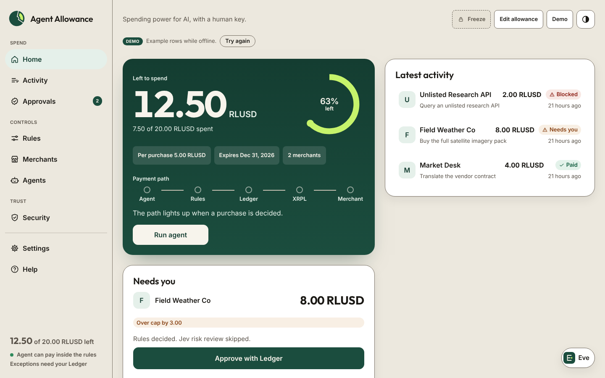
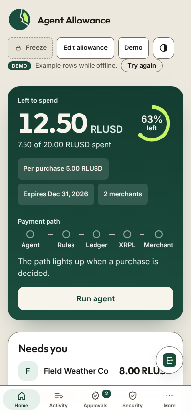
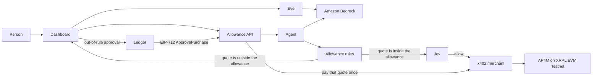

# Agent Allowance

Would you give an AI your credit card?

Agent Allowance is a spending account for an AI agent. You fund **20 RLUSD**. The agent may pay a merchant on its own only when the quote is on your allowlist, at or under a **5 RLUSD** cap, before the allowance expires, and still inside the budget. Anything else is not paid. It is saved for a person.

Built for the Mastercard × XRPL Hackathon, Agentic Finance track. Payments are **AP4M x402** vouchers settling **RLUSD** on **XRPL EVM Testnet** (chain ID `1449000`).

## Why XRPL

RLUSD is the settlement asset, and AP4M runs the payment channel on XRPL EVM Testnet. Gas is test XRP. A purchase does not open a new payment rail: the agent signs one voucher on the channel it already holds, the merchant redeems that voucher, and the channel stays open for the next payment. The on-chain step is that redemption. The marginal cost is the redemption's gas, not a fresh account setup each time.





The screenshots are the local dashboard after the three demo decisions: 1 RLUSD paid inside the rules, 8 RLUSD waiting on the cap, and an unlisted merchant waiting for a person. A funded live run fills in the testnet transaction and the AP4M receipt. The [90-second backup video](docs/demo-backup.mp4) uses a **simulated Ledger signature**, labeled on screen, for the approval step.

Pitch and click-path: [docs/DEMO_SCRIPT.md](docs/DEMO_SCRIPT.md).

## Problem

An agent that can pay for data is useful. An agent holding a card is not. The useful version needs a budget, a merchant list, a per-purchase cap, and an expiry, all checked before any signature. A person should be able to allow one exception without handing the agent the keys.

## How it works

1. **Rules, first.** `agent/rules.json` holds the allowance: 20 RLUSD budget, 5 RLUSD per purchase, an expiry, and an allowlist. `checkRules` reads the merchant's HTTP 402 quote and stops at the first failure: expired, merchant not allowed, over the cap, or over the budget. Nothing is signed on a failure.
2. **Jev, second.** Jev reviews a quote only after the rules allow it. A high risk score, a low "needed" score, or a review flag saves the quote. If Jev is down, the rules still decide and the row says so. Jev cannot spend past a rule.
3. **AP4M x402, when the quote is inside the allowance.** The agent reuses an open Channel, signs one voucher with `buyResource`, and the merchant redeems it on XRPL EVM Testnet. The dashboard keeps the transaction hash, claim id, receipt URL, and explorer link. The Channel stays open for the next payment. Voucher amounts are the running total on that Channel.
4. **Amazon Bedrock chooses; it does not spend.** When Bedrock is configured, the agent offers three live resources: the 1 RLUSD brief, the 8 RLUSD history, and the outside desk. The model returns an id or null. Null, an unknown id, or an error means nothing is signed, and the activity row says why. The rules and Jev still run after a real choice. The row is labeled **Amazon Bedrock**. If Bedrock is not configured, a deterministic fallback selects the 1 RLUSD brief and the row is labeled **Fallback (Bedrock not configured)**.
5. **Ledger, for one exception.** The 8 RLUSD history quote waits under **Needs you**. Approving it asks a Ledger Ethereum app, over Chrome WebHID, to sign an EIP-712 `ApprovePurchase` message. The dark panel shows the amount as `8 RLUSD`, the merchant label, and the expiry as a date. Chain id `1449000` stays in the domain. The device may show raw fields or a blind-signing prompt: `shared/erc7730-approve-purchase.json` is not in Ledger's registry for chain 1449000, so the device does not clear-sign it. The server rebuilds the panel's message, checks the signature recovers to `APPROVER_ADDRESS`, and checks it matches that quote and has not expired or been used. Only then does the same x402 path redeem that quote once. While that runs, the sheet shows Signed, Broadcasting, Settling, then Paid. A retry returns the attempt already in flight. The unlisted `0x0bad…` desk is on `deniedMerchants` because that payout is a fixed fake payee, not a team merchant, and a Ledger signature cannot pay it. Decline is the only action. A failed broadcast puts the row back under **Needs you** with a fresh challenge. The signature can pass the cap. It cannot pass an expired allowance, a budget that is already spent, or a channel that cannot be read or cannot cover the quote. Eve cannot approve a purchase, and she cannot raise the cap, the budget, the expiry, or the merchant list without a separate `SetAllowance` signature.



## How each sponsor is used

| Sponsor | What it does in this project |
| --- | --- |
| Agentic Finance track | The agent spends inside a funded allowance. Rules run before any signature, so the agent never holds a card. |
| Mastercard AP4M | x402 `PAYMENT-REQUIRED` quotes, an RLUSD Channel, one voucher per allowed purchase, redemption, settlement, and a receipt URL from the hackathon service. |
| Ledger | A person approves one out-of-rule quote on a Ledger Ethereum app. The device signs EIP-712 `ApprovePurchase` over WebHID. The panel shows the readable strings. The device may ask for blind signing because `shared/erc7730-approve-purchase.json` is not registered for chain 1449000. The server checks the signer, the quote, the expiry, and replay. |
| AWS | Amazon Bedrock (Converse API) chooses among the three live resources and writes Eve's open-ended replies. Null or an error signs nothing. Bedrock does not approve, deny, or sign a payment. With no AWS credentials, a labeled deterministic fallback selects the 1 RLUSD brief. |

## Bounty to files

| Bounty | Files |
| --- | --- |
| Agentic finance track | `agent/rules.js`, `agent/agent.js`, `agent/jev.js`, `dashboard/src/App.jsx` |
| Mastercard AP4M | `agent/ap4m-x402.mjs`, `agent/ap4m-hackathon-sdk.cjs`, `merchant/index.js`, `agent/agent.js` |
| Ledger | `shared/approval.js`, `shared/erc7730-approve-purchase.json`, `dashboard/src/ledger.js`, `server/ledger.js`, `server/allowance.js` |
| AWS Bedrock | `agent/planner.js`, `server/bedrock.js`, `server/eve.js` |
| XRPL EVM and RLUSD | `shared/network.json`, `agent/chain-spend.js`, `shared/catalog.js` |

XRPL EVM Testnet is the chain: chain ID `1449000`, RPC `https://rpc.testnet.xrplevm.org`, gas in test XRP from the [faucet](https://faucet.testevm.ripple.com). RLUSD has 18 decimals. This project refuses to run if the AP4M service reports another chain.

## Quickstart

Node.js 22.13 or newer.

```bash
npm install
npm install --prefix dashboard
cp .env.example .env
```

Fill `.env` on your machine. It is gitignored. Do not commit it, and do not paste keys into the dashboard. The service only ever receives signatures.

Team onboarding (agent wallet, merchant, funded budget) is done in the [participant portal](https://hackathon.ap4m.build/participant), not in this repo.

Four terminals, from the repo root:

```bash
npm run server      # http://127.0.0.1:8787
npm run merchant    # http://127.0.0.1:4308/resource
npm run dashboard   # http://127.0.0.1:5173
npm run demo        # one paid purchase, two saved quotes
```

`npm run demo` expects `MERCHANT_PAYOUT_ADDRESS` to be listed in `agent/rules.json`. The committed file still has placeholder merchants. If the payout is missing, the demo prints how to add it instead of paying. Write the real payout with:

```bash
npm run setup:payments -- --from /path/to/payment-starter --use-agent-as-submitter
```

That writes gitignored `.env` values and replaces `allowedMerchants` in `agent/rules.json` with the payout address. The budget, cap, expiry, and denylist stay. It does not move funds. A new channel uses the budget (20 RLUSD), not a 5 RLUSD test cap. `npm run preflight` checks that cap, the redeemed balance, both merchant routes, and the approver before you start.

Until the agent records a decision, the API serves sample rows and the dashboard shows an empty board with the full 20 RLUSD still unspent. Sample rows are a preview. They are not spent, and they cannot be approved. If the API is down, the dashboard opens on a labeled offline sample preview of those rows instead of an error page.

## Judge quickstart

1. Fund the agent wallet and the merchant submitter with test XRP from the [XRPL EVM Testnet faucet](https://faucet.testevm.ripple.com). Fund the team budget in the [participant portal](https://hackathon.ap4m.build/participant).
2. From the repo root, with `.env` filled in, start `npm run server`, `npm run merchant`, and `npm run dashboard`.
3. Run `npm run demo`. The 1 RLUSD brief pays. The 8 RLUSD history quote waits. The unlisted desk is decline-only.
4. Open [http://127.0.0.1:5173](http://127.0.0.1:5173).
5. Under **Needs you**, approve the **8 RLUSD** row on a Ledger.
6. Click the explorer link on that paid row.

Live explorer links belong in [docs/JUDGE_NOTE.md](docs/JUDGE_NOTE.md). Leave the TODO lines until a funded run fills them in.

### Environment

| Variable | What it is |
| --- | --- |
| `AGENT_PRIVATE_KEY` | Agent wallet. Signs vouchers. Never commit it. |
| `AP4M_API_URL` | `https://hackathon.ap4m.build` |
| `TEAM_NAME` | Team name, as registered. |
| `CHANNEL_ID` | Optional. Blank reuses an open Channel, or opens one. |
| `MERCHANT_PAYOUT_ADDRESS` | Where RLUSD is paid. Also allowlist this address. |
| `RESOURCE_URL` | `http://127.0.0.1:4308/resource` |
| `MERCHANT_ID` | Merchant id from the participant portal. |
| `MERCHANT_SUBMITTER_KEY` | Submits redemptions. Needs test XRP. Never commit it. |
| `APPROVER_ADDRESS` | Public Ethereum address of the Ledger account that may approve one quote. Not a key. |
| `JEV_API_KEY` | Optional. Blank means the rules decide alone. |
| `JEV_API_URL` | Optional. `https://thejevai.com`, or a self-hosted Kev URL. |
| `JEV_MODEL` | Optional. Defaults to `typesafe/jev-1.13`. |
| `AWS_REGION` | Optional Bedrock region. `AWS_DEFAULT_REGION` is used when this is blank. |
| `BEDROCK_MODEL_ID` | Optional. For example `us.amazon.nova-micro-v1:0`. |
| `AWS_BEARER_TOKEN_BEDROCK` | Optional Bedrock API key. Never commit it. |
| `AWS_ACCESS_KEY_ID` | Optional. Used when the bearer token is blank. Never commit it. |
| `AWS_SECRET_ACCESS_KEY` | Optional. Pairs with the access key. Never commit it. |
| `LLM_API_KEY` | Optional fallback for Eve. Stays on the server. |
| `LLM_BASE_URL` | Optional OpenAI-compatible base URL. |
| `LLM_MODEL` | Optional model name for that endpoint. |
| `ALLOWANCE_DEV_SIGNER` | Leave unset. Set to `1` only for the labeled backup demo in [docs/DEMO_SCRIPT.md](docs/DEMO_SCRIPT.md). |

`PORT` (8787) is the allowance API. `MERCHANT_PORT` (4308) is the 1 RLUSD merchant. `HISTORY_PORT` (4318) is the 8 RLUSD history merchant. The dashboard is `http://127.0.0.1:5173`. They are different processes. Port 4309 belongs to another local demo, so this one does not use it.

## Tests and build

```bash
npm test
npm --prefix dashboard run build
```

The tests cover the rules, a 402 read with no payment signature, a 1 RLUSD record, an 8 RLUSD block, an unlisted-merchant block, a Ledger signature that pays once, replay and mismatched-signer rejection, Jev not overriding a blocked rule, Eve lowering a cap after a confirm and refusing a raise without a `SetAllowance` signature, a mocked Bedrock plan that cannot pay a held quote, and the backup demo signer staying off unless `ALLOWANCE_DEV_SIGNER=1`.

## API

| Method | Path | Purpose |
| --- | --- | --- |
| GET | `/api/status` | Budget, spent, remaining, rules |
| GET | `/api/payments` | Payments, with hash, merchant, amount, and status |
| GET | `/api/pending` | Quotes waiting for a person |
| POST | `/api/approve/:id/challenge` | EIP-712 payload for the Ledger |
| POST | `/api/approve/:id` | Check a Ledger signature and pay that quote once. A retry while it is paying returns that attempt |
| GET | `/api/approve/:id/progress` | Signed, broadcasting, settling, or paid |
| POST | `/api/decline/:id` | Record a decline. Nothing is signed or paid |
| POST | `/api/eve` | Ask Eve. A change comes back as a confirmation |
| POST | `/api/eve/confirm` | Apply a confirmation token Eve just issued. A raise is refused here |
| POST | `/api/allowance/challenge` | EIP-712 `SetAllowance` payload when a raise needs the Ledger |
| POST | `/api/allowance` | Check that signature, then raise the cap, budget, expiry, or merchant list |
| POST | `/api/run-agent` | Start one purchase. Every state-changing POST must come from the dashboard origin, and every `/api` request must use a localhost host |

The ledger file is `server/data/store.json`. It is created on first run and is not committed.

## Safety

- Private keys and API keys stay in `.env`. They are not committed, not logged, and not sent to the browser.
- The agent key is used to sign. It is not sent to the AP4M service.
- Do not send RLUSD or XRP to the vault or ledger contracts. Channels and vouchers go through the AP4M kit.
- Operator, PSP, payout, release, and admin keys belong to the service. This repo does not configure them.
- Testnet only. The agent stops if the service reports another chain id.
- `ALLOWANCE_DEV_SIGNER` is off by default. The dashboard does not contain the dev signer. With the flag on, the approval button is labeled **simulated Ledger signature** and no voucher is broadcast.
