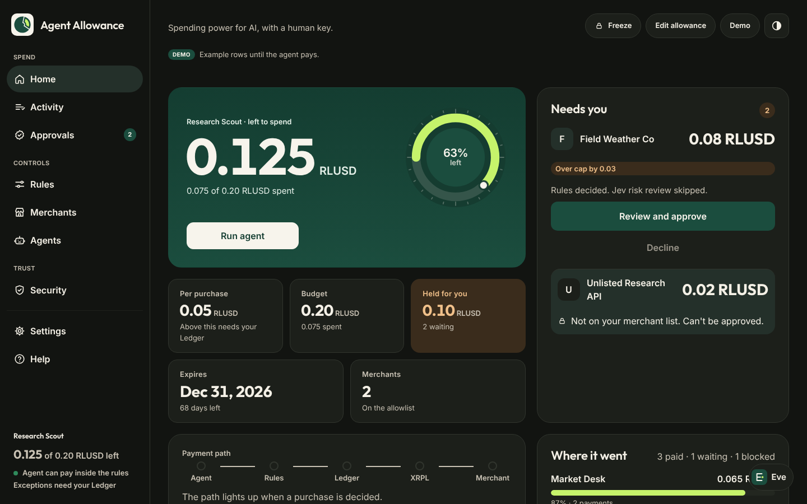
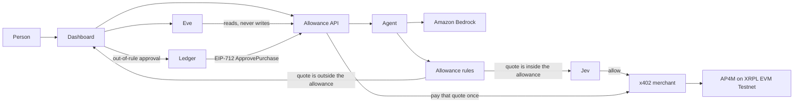

# Agent Allowance

<picture>
  <source media="(prefers-color-scheme: dark)" srcset="dashboard/public/brand/lockup-horizontal-dark.svg" />
  
</picture>

Spending power for AI, with a human key.




[](https://github.com/michaelnjoku347/Agent-allowance/actions/workflows/test.yml)

Would you give an AI your credit card? Agent Allowance is a spending account for an AI agent. You fund a small budget, **0.20 RLUSD** in the demo. The agent pays a merchant on its own only when the quote is from a merchant on your list, at or under a **0.05 RLUSD** cap per purchase, before the allowance ends, and still inside the budget. Anything else waits for you, and your Ledger approves it.

Payments are **AP4M x402** vouchers settling **RLUSD** on **XRPL EVM Testnet** (chain ID `1449000`). Built for the Mastercard × XRPL Hackathon, **Agentic Finance** track.

## Try it

### In a browser, with nothing to install

Deploy the hosted public demo to Render from `render.yaml` in a few clicks; [docs/DEPLOY.md](docs/DEPLOY.md) has the steps. Every visitor gets a private sandbox with the sample data. Approvals use a clearly labeled **simulated Ledger signature**, and Run agent records simulated payments, so nothing is broadcast and no key is needed.

### On your computer

1. Install [Node.js 22.13 or newer](https://nodejs.org).
2. Clone this repository and copy `.env.example` to `.env`.
3. Run `npm start` from the repository root. On Windows you can double-click `start.bat`; on Mac or Linux, `./start.sh` does the same.

The dashboard opens at [http://127.0.0.1:5173](http://127.0.0.1:5173). `npm start` checks the Node version, installs dependencies when they are missing or out of date (it reinstalls `dashboard/` when its lockfile changed), clears a merchant lock left behind by a crash, and starts the allowance API and the dashboard together. Blank AWS and Jev keys are fine: the app prints a one-line notice and keeps going.

- `npm run start:phone` binds the dashboard so a phone on the same Wi-Fi can open it, and prints `On your phone: http://<LAN-IP>:5173`.
- `npm run ship` builds the Docker image and serves the dashboard and API together at [http://127.0.0.1:8787](http://127.0.0.1:8787). A `.env` is passed in when it exists and never copied into the image.

A paid run on testnet also needs the keys in `.env` and `npm run merchant` in a second terminal. See [Funded run](#funded-run).

## What you can do

- **See where you stand.** Home shows what is left as the gauge disk, the five limits as tiles, the payment path with the latest decision, spend by merchant, and the latest activity as a table.
- **Set it up in a minute.** The first visit plays four short slides, then a guided setup: name the agent, set the budget and cap, choose merchants, pick an end date, and connect your Ledger as the approver.
- **Understand every hold.** Approvals shows the rule a purchase hit, the price, your cap, how far over it is, what is left after, exactly what your Ledger signs, and what happens next.
- **Edit the allowance.** The Rules page previews each change as **Applies now** (lowering) or **Ledger signs** (raising, or adding a merchant), and shows the five checks in the order they run.
- **Search your history.** Filter by outcome, merchant, period, or any text (merchant, task, reason, transaction hash), see exact totals, and export the rows as CSV.
- **Ask Eve anything.** Eve reads the whole account and answers with real numbers: what is left, what was spent where and when, why something waits, trends, the audit log, the channel. She handles several questions at once and suggests next steps. She can open pages, filter history, highlight a payment, export a CSV, and open the editor or an approval for you. She never signs, spends, changes rules, or unfreezes; she can only propose a freeze or a decline, which you confirm.
- **Stop everything.** Freeze stops every new signature at once and closes the payment channel. Unfreeze is always one obvious button away; the next run opens a new channel.

The dashboard is built to WCAG 2.1 AA: it works with a keyboard and a screen reader, axe-core reports no violations on any page in either theme, it follows your system's reduced-motion setting, and it fits a 320 px phone.

## How it works

1. **Rules, first.** `agent/rules.json` holds the allowance: a 0.20 RLUSD budget, 0.05 RLUSD per purchase, an end date, and an allowlist. `checkRules` reads the merchant's HTTP 402 quote and stops at the first failure: expired, merchant not allowed, over the cap, or over the budget. Nothing is signed on a failure.
2. **Jev, second.** Jev reviews a quote only after the rules allow it. A high risk score, a low "needed" score, or a review flag holds the quote for a person. If Jev is down, the rules still decide and the row says so. Jev cannot spend past a rule.
3. **AP4M x402, inside the allowance.** The agent reuses an open Channel, signs one voucher with `buyResource`, and the merchant redeems it on XRPL EVM Testnet. The dashboard keeps the transaction hash, claim id, receipt URL, and explorer link. Voucher amounts are the running total on that Channel.
4. **Amazon Bedrock chooses; it does not spend.** With Bedrock configured, the agent offers three live resources: the 0.01 RLUSD brief, the 0.08 RLUSD history, and the outside desk. The model returns an id or nothing; anything else signs nothing. Without Bedrock, a deterministic fallback picks the brief and the row says **Fallback (Bedrock not configured)**.
5. **Ledger, for one exception.** The 0.08 RLUSD history quote waits under **Needs you**. Approving it asks a Ledger Ethereum app, over WebHID, to sign an EIP-712 `ApprovePurchase` message for exactly that merchant, amount, and window. The server checks the signature recovers to `APPROVER_ADDRESS`, matches that quote, and has not expired or been used, then pays it once through the same x402 path. A signature can pass the cap; it cannot pass an unlisted merchant, an ended allowance, the budget, or a channel that cannot cover the quote. Raising a limit is a separate `SetAllowance` signature.



## Sponsor map

Each sponsor is on the path. Take one out and that step stops.

| Sponsor | The job only that sponsor does | Where |
| --- | --- | --- |
| Ledger | Signs one exception (`ApprovePurchase`), an allowance raise (`SetAllowance`), and the agent mandate (`AgentMandate`). The ERC-7730 file names those fields for clear signing. Chain 1449000 is not in Ledger's registry, so the device may ask for blind signing; the approval sheet shows the same words. | `shared/approval.js`, `shared/mandate.js`, `shared/erc7730-approve-purchase.json`, `dashboard/src/ledger.js` |
| Mastercard AP4M | Every payment is an x402 voucher on a channel. The receipt shows the AP4M channel id and claim id when the service returns them. | `agent/ap4m-x402.mjs`, `merchant/index.js`, `agent/agent.js` |
| AWS | Amazon Bedrock chooses the resource and can reword Eve's answers. It cannot sign, add an action, or raise a limit. | `agent/planner.js`, `server/bedrock.js`, `apprunner.yaml` |
| XRPL | RLUSD settles on XRPL EVM Testnet, chain `1449000`. **Anchor the latest decision** puts the audit hash in a transaction's data. | `shared/network.json`, `agent/anchor.js`, `agent/chain-spend.js` |

RLUSD settles on the channel the agent already holds: a purchase is one voucher and one redemption, not a new payment rail. Pitch and click-path: [docs/DEMO_SCRIPT.md](docs/DEMO_SCRIPT.md). Production plan: [docs/PATH_TO_PRODUCTION.md](docs/PATH_TO_PRODUCTION.md).

## Funded run

Team onboarding (agent wallet, merchant, funded budget) happens in the [participant portal](https://hackathon.ap4m.build/participant). Fund the agent wallet and the merchant submitter with test XRP from the [XRPL EVM Testnet faucet](https://faucet.testevm.ripple.com).

```bash
npm install
npm install --prefix dashboard
cp .env.example .env            # fill it in; it is gitignored
npm run setup:payments -- --from /path/to/payment-starter --use-agent-as-submitter
npm run preflight               # checks the channel cap, balances, both merchants, the approver
```

Then, from the repository root:

```bash
npm start                       # API on :8787 and dashboard on :5173
npm run merchant                # x402 merchant on :4308, history merchant on :4318
npm run demo                    # one paid 0.01 purchase, two held quotes
```

Approve the **0.08 RLUSD** row under **Needs you** on your Ledger and open the explorer link on the paid row. Live explorer links for judging go in [docs/JUDGE_NOTE.md](docs/JUDGE_NOTE.md).

`setup:payments` replaces `allowedMerchants` in `agent/rules.json` with your payout address and keeps the budget, cap, end date, and denylist. A new channel's cap is the budget (0.20 RLUSD), not the 0.05 RLUSD channel-cap test size; check the channel limits per budget deposit in [`/llms.txt`](https://hackathon.ap4m.build/llms.txt). Until the agent records a real decision, the dashboard shows labeled sample rows.

### Environment

| Variable | What it is |
| --- | --- |
| `AGENT_PRIVATE_KEY` | Agent wallet. Signs vouchers. Never commit it. |
| `AP4M_API_URL` | `https://hackathon.ap4m.build` |
| `TEAM_NAME` | Team name, as registered. |
| `CHANNEL_ID` | Optional. Blank reuses an open Channel, or opens one. |
| `CHANNEL_CAP` | Optional. Cap for a new Channel. Defaults to the budget. |
| `MERCHANT_PAYOUT_ADDRESS` | Where RLUSD is paid. Also allowlist this address. |
| `RESOURCE_URL` | `http://127.0.0.1:4308/resource` |
| `PRICE_RLUSD` | Optional. Price of `GET /resource`. Defaults to 0.01; keep it at or under the cap. |
| `MERCHANT_ID` | Merchant id from the participant portal. |
| `MERCHANT_SUBMITTER_KEY` | Submits redemptions. Needs test XRP. Never commit it. |
| `APPROVER_ADDRESS` | Public address of the Ledger account that approves exceptions. Not a key. When it is unset, setup can name the approver once; after that only a server-side edit changes it. |
| `JEV_API_KEY`, `JEV_API_URL`, `JEV_MODEL` | Optional risk review. Blank means the rules decide alone. |
| `AWS_REGION`, `BEDROCK_MODEL_ID`, `AWS_BEARER_TOKEN_BEDROCK` or `AWS_ACCESS_KEY_ID` + `AWS_SECRET_ACCESS_KEY` | Optional Amazon Bedrock. Never commit the keys. |
| `LLM_API_KEY`, `LLM_BASE_URL`, `LLM_MODEL` | Optional OpenAI-compatible model to reword Eve's answers. Stays on the server. |
| `ALLOWANCE_DEV_SIGNER` | Leave unset. `1` turns on the labeled backup demo signer. |
| `ALLOWANCE_RATE_LIMIT` | Optional. Scales the API's per-client rate limits; `0` turns them off. |
| `PUBLIC_DEMO`, `PUBLIC_DEMO_PAYMENTS`, `PUBLIC_HOSTNAME`, `HOST` | Hosted demo settings. See [docs/DEPLOY.md](docs/DEPLOY.md). |

`PORT` (8787) is the allowance API, `MERCHANT_PORT` (4308) the 0.01 RLUSD merchant, `HISTORY_PORT` (4318) the 0.08 RLUSD history merchant, and the dashboard is on 5173.

## API

| Method | Path | Purpose |
| --- | --- | --- |
| GET | `/api/health` | API, rules, and merchant reachability, in plain words. 503 when the rules cannot be read |
| GET | `/api/status` | Budget, spent, remaining, rules, freeze state, profile |
| GET | `/api/payments` | Payments, with hash, merchant, amount, and status |
| GET | `/api/pending` | Quotes waiting for a person |
| GET | `/api/events` | Server-sent events: store changes and the live payment stage |
| GET | `/api/audit` | Every allow, block, approval, and freeze, with the rule and the signer |
| POST | `/api/approve/:id/challenge` | EIP-712 payload for the Ledger |
| POST | `/api/approve/:id` | Check a Ledger signature and pay that quote once |
| GET | `/api/approve/:id/progress` | Signed, broadcasting, settling, or paid |
| POST | `/api/decline/:id` | Record a decline. Nothing is signed or paid |
| POST | `/api/allowance/preview` | What a change would do, and whether the Ledger must sign it. Writes nothing |
| POST | `/api/allowance/lower` | Apply a change that only lowers limits. Any raise is refused with 403 |
| POST | `/api/allowance/challenge` | EIP-712 `SetAllowance` payload for a raise |
| POST | `/api/allowance` | Check that signature, then apply the raise |
| POST | `/api/freeze` | Freeze (`{"frozen": true}`) or unfreeze (`{"frozen": false}`) |
| POST | `/api/eve` | Ask Eve. A freeze or decline comes back as a proposal to confirm; UI steps come back as `ui` |
| POST | `/api/eve/confirm` | Run a freeze or decline the person confirmed. Nothing else is accepted |
| POST | `/api/profile` | The agent's name and when setup finished |
| POST | `/api/approver` | Name the approver once; refused when one is set |
| POST | `/api/run-agent` | Start one purchase |

Every state-changing request must come from the dashboard origin, any request body must be JSON, every `/api` request must use an allowed host, and every route is rate limited. The ledger file is `server/data/store.json`, created on first run and never committed.

## Security model

- **Rules decide before anything is signed**, and an unreadable rules file fails closed: the API returns `rules_unavailable` and nothing is paid.
- **Inputs are shape-checked** on every route: ids, amounts (at most 18 decimals), dates, addresses, and text lengths. Unknown allowance fields are refused rather than ignored.
- **Raises need a signature.** Lowering a limit applies directly; raising the cap, the budget, or the end date, or adding a merchant, needs a `SetAllowance` signature from the approver. The dashboard can never replace the approver once one is set.
- **Eve cannot act on her own.** She reads; the only things she can propose are a freeze and a decline, and the server runs them only after the person confirms. A model may reword her answers but cannot add an action.
- **Keys stay out of the code and the logs.** Private keys and API keys live in `.env` (gitignored) or the host's secret store. Logs strip key values and anything shaped like a private key. The agent key signs locally and is never sent to the AP4M service.
- **Safe defaults.** The API binds to localhost, answers only localhost or a configured public hostname (DNS-rebinding guard), sends `nosniff`, `DENY` framing, `no-referrer`, and `no-store`, and serves the built dashboard under a strict Content-Security-Policy.
- **Testnet only.** The agent stops if the service reports another chain. Operator, PSP, payout, release, and admin keys belong to the service and are never configured here. Do not send RLUSD or XRP to the vault or ledger contracts.
- **The backup signer is labeled.** `ALLOWANCE_DEV_SIGNER` is off by default, the dashboard never contains it, and every screen that uses it says **simulated Ledger signature**.

## Tests and build

```bash
npm test
npm --prefix dashboard run build
```

The suite covers the rules and their order, quotes and vouchers, Ledger approvals (one payment, replay, wrong signer, expiry), allowance changes (lower applies, raise needs a signature), the API guardrails (validation, rate limits, headers, fail closed), the reconnecting event stream, history filters and CSV, approval explanations, Eve on about thirty realistic owner questions and every boundary, onboarding, the hosted demo's sandboxes, the Windows launcher helpers, and two headless-Chrome checks: phone layouts at 320 and 390 px, and the onboarding dialog's keyboard, focus, and reduced-motion behavior. The browser checks need Chrome or Chromium; set `CHROME_PATH` if it is not found.

## Troubleshooting

| You see | Do this |
| --- | --- |
| "Can't reach the allowance server" | The API is not running. Run `npm start` again; the page retries on its own. |
| "Merchant offline" | Start the merchant with `npm run merchant`. Your allowance is safe in the meantime. |
| `merchant.lock exists` | `npm start` and `npm run merchant` remove a lock no running merchant holds. Never delete `merchant.sqlite`. |
| `spawn EINVAL` on Windows | Update to this version: npm is now started through a shell on Windows. |
| A port is already in use | Close the other window running Agent Allowance, then run `npm start` again. |
| "Payments are stopped" | `agent/rules.json` could not be read. Fix the JSON and retry. |
| Too many requests | Wait the number of seconds shown. Nothing was paid. |
